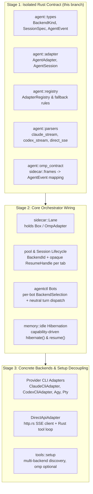

# Momo Rust-First Multi-Agent Runtime Architecture

> **Status**: Stage 1 + Stage 2A/2B/2C isolated core completeness (`orca/rust-multi-agent-s1`)
> **Scope**: `native/ompdesk/crates/core/src/agent/`
> **Related tracks**: `#12` (`sidecar::lane`, `memory`, `pool`, `procs`), `#11` (`hub`, `owner`), `#9` (`tools/setup`, `tauri-shell/src/ipc_router`), `#10`/`#76` (UI)

## 1. Purpose

OMPdesk (`ompdesk-core`) was originally built around a single execution engine: spawning stock `omp --mode rpc-ui -e resources/gui-bridge/index.ts` over stdio and coordinating live session state over the gui-bridge socket.

This architecture introduces an **agent-neutral Rust runtime boundary** (`crates/core/src/agent/`) so three first-class execution backend families run behind one normalized event stream, one session lifecycle, and one capability-negotiated registry:

1. **Provider CLI** — external vendor agent CLIs managed directly from Rust over `tokio::process` pipes (no Node SDK wrapper):
   - **Claude Code** (`claude --print --input-format stream-json --output-format stream-json --verbose --include-partial-messages`, session continuity via `--resume <session_id>`)
   - **Codex CLI** (`codex app-server` JSON-RPC 2.0 over NDJSON and `codex exec --json` JSONL)
   - **Antigravity** (`agy` / ACP structured protocol)
   - **Generic PTY** (universal fallback for arbitrary terminal-first CLIs)
2. **OMP** — existing stock `omp` refactored behind `AgentAdapter` as an **optional adapter** rather than a hard core dependency, preserving full `gui-bridge` fidelity when `omp` is chosen while allowing OMPdesk to boot and run without `omp` installed.
3. **Direct LLM API** — native Rust HTTP/1.1 + TLS streaming built on the core's existing `crates/core/src/http.rs` stack (`hyper` + `tokio-rustls` + `rustls-platform-verifier`), speaking:
   - **Anthropic Messages API** (`/v1/messages`, SSE)
   - **OpenAI Responses API** (`/v1/responses`, SSE)
   - **OpenRouter** (`/api/v1/chat/completions`, SSE)
   - **OpenAI-compatible endpoints** (local Ollama / vLLM / LiteLLM / enterprise gateways)
   - Paired with a lightweight built-in Rust tool execution loop (file read/write/edit, shell exec, MCP tool dispatch, approval gating) requiring **zero external CLI**.

---

## 2. Three-Stage Migration Plan

The migration follows the repo's strangler discipline: Stage 1 lands completely isolated with zero file overlap against active branches, Stage 2 wires the core orchestrators onto `agent::AgentAdapter` behind a dual-path seam, and Stage 3 ships the concrete Provider CLI and Direct API adapters and removes the hard `omp` boot requirement.

### Stage 1 — Isolated Contract, Registry & Parsers (`orca/rust-multi-agent-s1`)

- **Owned files**: `native/ompdesk/crates/core/src/agent/*`, a single `pub mod agent;` declaration in `crates/core/src/lib.rs`, and this document.
- **Zero Cargo.lock delta**: Uses only existing `ompdesk-core` workspace dependencies (`serde`, `serde_json`, `tokio`). Object-safe async traits use `Pin<Box<dyn Future<Output = T> + Send + 'a>>` (`BoxFuture`) instead of adding `async-trait`.
- **Deliverables**:
  - Normalized types (`types.rs`): `BackendKind`, `ProviderCliKind`, `DirectApiProvider`, `BackendId`, `AgentCapabilities`, `CapabilityRequirements`, `SessionSpec`, `ResumeHandle`, `AgentEvent`, `AgentError`, and discovery records.
  - Dyn-compatible `AgentAdapter` trait + `AgentSession` handle (`adapter.rs`).
  - `AdapterRegistry` with deterministic backend resolution, user-install-first discovery precedence, and capability fallback rules (`registry.rs`).
  - Pure-Rust, unit-tested streaming parsers (`parsers/claude_stream.rs`, `parsers/codex_stream.rs`, `parsers/direct_sse.rs`).
  - Executable OMP frame translation contract (`omp_contract.rs`) mapping stock `sidecar::frames` JSON payloads to `AgentEvent` and classifying OMP-only passthrough frames.

### Stage 2A / 2B / 2C — Isolated Core Completeness (`orca/rust-multi-agent-s1`)

Still strictly isolated inside `native/ompdesk/crates/core/src/agent/*` (zero overlap with `#12`, `#11`, `#9`, or `Cargo.lock`):

- **Stage 2A (Concrete Backends & Discovery)**: `backends/detect.rs`, `backends/claude_cli.rs` (`ClaudeCliAdapter`), `backends/codex_cli.rs` (`CodexCliAdapter` for `exec --json` and `app-server`), and `backends/direct_api.rs` (`DirectApiAdapter` over `hyper` + `tokio-rustls`).
- **Stage 2B (Direct API Local Tool Loop)**: `tools/local_executor.rs` (`LocalToolExecutor` with workspace-confined `read_file`, `write_file`, `list_dir`, `run_command`) closing the bounded multi-round tool loop in `DirectApiAdapter`.
- **Stage 2C (Antigravity CLI, Direct API Journal & Backend Service)**:
  - `backends/antigravity.rs`: `AntigravityCliAdapter` (`agy` stream-json + ACP parser, process lifecycle, cancellation, hibernate/resume) registered in `AdapterRegistry::with_default_backends*` (8 default backends).
  - `journal.rs`: atomic JSONL `JournalStore` (`direct:<journal_id>`) persisting conversation messages, tool calls/results, token usage, and metadata with crash-safe corrupt-tail recovery and round-trip `DirectApiAdapter::resume`.
  - `service.rs`: self-contained `AgentBackendService` exposing JSON-serializable `list_backends()`, `detect_backends()`, `resolve_backend(request)`, and secret-redacted `health_check(backend_id)` models ready for direct `Route::Core` and UI wiring.

### Stage 2 — Decoupling Core Orchestrators onto `agent::AgentAdapter`

Once active branches `#12` (`sidecar/lane`, `memory`, `pool`, `procs`), `#11` (`hub`, `owner`), and `#9` (`tools/setup`, `tauri-shell/ipc_router`) land on `dev`:

1. **`sidecar::Lane` (`crates/core/src/sidecar/lane.rs`)**
   - Extract the OMP-specific process spawn, `frames::Decoder`, `bridge::Bridge`, and `stream::Stream` slimmer into `agent::omp::OmpAdapter` implementing `AgentAdapter`.
   - Update `Lane` so a tab's active runtime is a backend-neutral `AgentSession` (with an optional `OmpBridgeChannel` escape hatch only when `session.kind() == BackendKind::Omp` for OMP-exclusive GUI commands like `/copy` targets, model-role catalog, and `gui-bridge` extensions).
   - Pump `AgentSession::take_events()` on the lane loop: emit normalized `agent.event` frames to `sidecar::tap` subscribers, remote link encoders, and the IPC bridge, while translating `OmpAdapter` outbound frames through `omp_contract::translate_omp_frame` so legacy renderer consumers keep working during cutover.
2. **`pool` & Session Lifecycle (`crates/core/src/pool/*`, `src/main/sidecar-pool.ts`, `src/main/sidecar-factory.ts`)**
   - Replace OMP-only `resume_session_path: Option<String>` in tab state and persistence with `ResumeHandle { backend, native_id, cwd, checkpoint_cursor, metadata }`.
   - Generalize session ownership claims (`pool::claims`) so non-file-backed handles (`claude:<uuid>`, `codex:<thread_id>`, `direct:<journal_id>`) participate in the same single-owner fence as OMP JSONL files.
   - Map `SessionLifecycleState` cleanly to the UI's existing `SidecarStatus` surface via `omp_contract::map_sidecar_status` (and its inverse) so the renderer experiences zero regressions while migrating.
3. **Bots (`crates/core/src/agentctl/journal/bots.rs`, `service/work/bots.rs`, `src/main/bots.ts`)**
   - Extend `BotRecord` with an optional `backend: Option<BackendId>` (defaulting to `None` -> registry default / `Omp` for backward compatibility with existing `bots.json`).
   - Route bot kickoffs, scheduled `look_around` runs, and peer mail wakeups through `AgentAdapter::start` / `send_turn` / `steer` instead of constructing OMP-specific CLI launch flags (`omp_launch`) and relying exclusively on `gui-bridge`'s `agent_control.bot` RPC.
   - Preserve bot folder isolation (`cwd = bot.folder`), approval policy (`BotRecord.chat_approval` -> `SessionSpec.approval_mode`), and quiet notification rules uniformly across all backends.
4. **Idle Hibernation (`crates/core/src/memory/idle.rs`, `src/main/memory-watch.ts`, `src/main/idle-release.ts`)**
   - Today `memory::idle::WatchProcesses` identifies quiet tabs via OS process trees (assuming a Windows `omp.exe -> bun.exe` launcher shape) and releases them via `sidecar.sleep`.
   - Under `AgentAdapter`:
     - Each live `AgentSession` exposes `pid() -> Option<u32>` and `capabilities().idle_hibernation`.
     - Process-backed backends (`Omp`, `ClaudeCode`, `Codex`) register their root PID with `memory::idle` using backend-agnostic subtree accounting (any quiet process tree with no non-console active tool descendants, not hard-coded to `omp.exe`).
     - Releasing an idle tab calls `adapter.hibernate(&mut session)`, which flushes any pending state, persists the returned `ResumeHandle` on the tab record, and cleanly terminates the child process tree.
     - `DirectApi` sessions carry `pid() == None` (zero OS child process footprint); `hibernate()` flushes the local conversation journal and drops in-memory buffers immediately, making them virtually free when idle.
     - Waking a hibernated tab calls `adapter.resume(handle, spec)` transparently on the next user prompt or focus event.

### Stage 3 — Concrete Backends, Direct API Tool Loop & Setup Decoupling

1. **Provider CLI Adapters** (`crates/core/src/agent/providers/`):
   - `ClaudeCliAdapter`: Spawns user-installed `claude` with `--print --input-format stream-json --output-format stream-json --verbose --include-partial-messages` (+ `--resume <native_id>` on resume, `--mcp-config <temp_json>` for `mcp_hub`), feeds stdout lines into `parsers::claude_stream::ClaudeStreamParser`, and writes NDJSON user envelopes & `control_response` approval replies to stdin.
   - `CodexCliAdapter`: Prefers `codex app-server` (long-lived JSON-RPC 2.0 session with thread resume, mid-turn steering, and structured approval replies) and falls back to `codex exec --json` when older Codex CLI builds lack `app-server`, feeding lines into `parsers::codex_stream::CodexStreamParser`.
   - `AntigravityAdapter` & `GenericPtyAdapter`: Structured ACP transport for `agy` and PTY-backed fallback for unmodeled CLIs.
2. **Direct LLM API Adapter** (`crates/core/src/agent/direct/`):
   - Extends `crates/core/src/http.rs` with a streaming response body path (`hyper::body::Incoming` chunk iterator) reusing the core's existing TLS (`rustls-platform-verifier` + `NODE_EXTRA_CA_CERTS`) and proxy resolution (`crates/core/src/proxy.rs`).
   - Feeds HTTP response chunks directly into `parsers::direct_sse::DirectSseParser`.
   - Runs a bounded, cancellation-safe Rust agent loop: model stream -> `ToolCallStarted`/`ToolCallDelta` -> optional `ApprovalRequested` wait -> local tool execution (workspace fs, bounded shell via `run.rs`, loopback `mcp_hub` HTTP calls) -> `ToolCallFinished` -> next model turn until `TurnFinished`.
   - Persists turns to an append-only local JSONL journal under `<userData>/sessions/direct/` so `ResumeHandle` and idle hibernation work identically to CLI sessions.
3. **Setup & Onboarding Decoupling (`crates/core/src/tools/setup/*`)**:
   - Replace the single-backend `omp` readiness gate with `AdapterRegistry::detect_all()`.
   - A machine with any installed Provider CLI **or** a configured Direct API key boots straight into a ready composer; `omp` becomes an opt-in installable backend rather than a prerequisite.

---

## 3. Backend Capability Matrix

| Capability | Provider CLI: Claude Code (`stream-json`) | Provider CLI: Codex (`app-server` / `exec --json`) | Provider CLI: Antigravity (`agy` / ACP) | Provider CLI: Generic PTY | OMP (`omp --mode rpc-ui`) | Direct LLM API (Anthropic / OpenAI / OpenRouter / Compat) |
| :--- | :--- | :--- | :--- | :--- | :--- | :--- |
| **Streaming text deltas** | Yes (`stream_event` `text_delta` w/ `--include-partial-messages`) | Yes (`item/agentMessage/delta` in `app-server`; `item.updated` in `exec`) | Yes (ACP stream updates) | Partial (raw VT-stripped text chunks) | Yes (`message_update` `text_delta`, slimmed by `sidecar::stream`) | Yes (native SSE: `text_delta`, `output_text.delta`, `choices[].delta.content`) |
| **Streaming thinking deltas** | Yes (`thinking_delta`) | Yes (`item/reasoning/textDelta` & `summaryTextDelta`) | Yes (provider-dependent) | No | Yes (`message_update` `thinking_delta`) | Yes (Anthropic `thinking_delta`, OpenAI `reasoning_*`, OpenRouter `reasoning_content`) |
| **Structured tool calls** | Yes (`tool_use` / `input_json_delta` / `tool_result`) | Yes (`commandExecution`, `fileChange`, `mcpToolCall`, `webSearch`) | Yes (ACP tool call items) | No (opaque terminal output) | Yes (`tool_execution_start` / `update` / `end`, `host_tool_call`) | Yes (built-in Rust tool loop + SSE tool argument deltas) |
| **Approvals & prompts** | Yes (`control_request` `can_use_tool` over stdio) | Yes (JSON-RPC server requests in `app-server`; policy flags in `exec`) | Yes (ACP permission requests) | No (inline terminal prompt only) | Yes (`extension_ui_request`: `confirm`, `select`, `ask`, `form`, `input`) | Yes (native pre-execution gate in Rust tool loop) |
| **Mid-turn steer** | Yes (queued user envelope on stdin; cut-off step awareness) | Yes (`app-server` turn steer; No in `exec --json`) | Yes (ACP cancel/steer) | Limited (stdin write) | Yes (stock `steer` & `follow_up` lanes + `held_queue`) | Yes (inject user steering message at next tool-loop boundary) |
| **Interrupt / Stop** | Yes (`control_request` interrupt + process signal fallback) | Yes (`turn/interrupt` RPC or SIGINT) | Yes (ACP cancel) | Yes (Ctrl-C / SIGINT) | Yes (`abort`, `abort_and_restore_queue`, `sidecar::stop`) | Yes (drop `hyper` response stream + cancel active tool future) |
| **Resume IDs** | Yes (`session_id` UUID via `--resume <id>`) | Yes (`threadId` via `thread/resume` or `codex exec resume`) | Yes (ACP session ID) | No (ephemeral PTY only) | Yes (OMP session JSONL path + leaf entry ID) | Yes (local JSONL journal ID + message cursor) |
| **Idle hibernation** | Yes (persist `session_id`, terminate child, respawn w/ `--resume`) | Yes (persist `threadId`, close `app-server`, reopen w/ `thread/resume`) | Yes (persist ACP session ID, respawn) | No (killing PTY loses shell state) | Yes (`sidecar.sleep` -> terminate `omp`, respawn on session file) | Yes (zero child process; flush journal & drop memory buffers) |
| **MCP bridge (`mcp_hub`)** | Yes (`--mcp-config` pointing at loopback `mcp_hub`) | Yes (`-c mcp_servers.*` / `app-server` MCP config) | Yes (ACP MCP servers) | No | Yes (native `gui-bridge` + stock MCP extensions) | Yes (Rust tool loop translates `mcp_hub` tools into native tool schemas) |
| **Installed-CLI detection** | `PATH` + login-shell + known install paths (`claude --version`) | `PATH` + login-shell + WSL guest-native filter (`codex --version`) | `PATH` (`agy --version`) | Configured command path check | `omp-runtime` package check + `MIN_OMP_VERSION` + Bun floor | Zero CLI needed (detects configured API key / local base URL reachability) |
| **Child process footprint** | 1 CLI process (+ tool children) | 1 `app-server` process (shareable) or 1 `exec` process | 1 `agy` process | 1 PTY + shell | 1 Bun/`omp` process + `gui-bridge` socket | **0 child processes** (in-core Rust task; ephemeral tool children only) |

---

## 4. Reference Comparison: `/tmp/orca-src-research` vs. Momo Rust Design

Reviewing Orca's production TypeScript multi-agent implementation in `/tmp/orca-src-research` surfaced key lessons and architectural trade-offs that directly shaped `crates/core/src/agent/`:

### How `/tmp/orca-src-research` Is Structured

1. **`src/main/claude/` and `src/main/claude/structured/`**
   - `claude-stream-json-connection.ts` lazily imports `@anthropic-ai/claude-agent-sdk` (`query()`), wraps it with a custom process spawner (`createClaudeCodeProcessSpawn`), scrubs inherited `CLAUDE_CONFIG_DIR` and rejected API keys, and tracks physical process exit via a two-tier `root` + `tree` descendant reaper (`createClaudeChildTreeReaper`).
   - `claude/structured/claude-structured-session-adapter.ts` implements `StructuredAgentSessionAdapter` (~380 lines in `src/main/native-chat/agent-session-wire/providers/structured-agent-session-adapter.ts`), orchestrating 30+ helper modules under `structured/{journal,turns,lifecycle,launch,dispatch,permissions,startup}` to map Claude frames into Orca's journal rows, provisional subagent attributions, steer echo holds, rewind forks, and account-home moves.
2. **`src/main/codex-cli/` and `src/main/codex/app-server/`**
   - `codex-cli/command.ts` resolves the user's `codex` binary (skipping Windows-only shims inside WSL guests) before falling back to Orca's managed copy.
   - `codex/app-server/` speaks JSON-RPC 2.0 over bounded-line NDJSON (`codex-app-server-record-dispatch.ts`), distinguishes server requests (`id` + `method`) from notifications (`method` only) and replies (`id` only), handles oversized-frame rejection without wedging waiters, and enumerates 88 notification discriminators (`codex-app-server-notification-schema.ts`).
3. **`src/main/managed-agent-cli/managed-agent-cli-registry.ts`**
   - Centralizes 10 managed CLI runtimes (`claude`, `codex`, `opencode`, `opencode2`, `cursor`, `copilot`, `grok`, `kimi`, `omp`, `antigravity`).
   - Enforces a clear precedence rule: **the user's own installed CLI always wins**; managed copies serve hosts without one and are appended last on `PATH` so they never shadow user binaries.

### How Momo's Rust Trait Design Simplifies and Improves on It

| Dimension | `/tmp/orca-src-research` (TypeScript / Electron) | Momo `crates/core/src/agent/` (Rust) |
| :--- | :--- | :--- |
| **Protocol transport** | Depends on `@anthropic-ai/claude-agent-sdk` (Node) for Claude and separate TS transports for Codex/ACP/OMP | Pure-Rust NDJSON & SSE parsers (`parsers/*`) over `tokio::process` and `http.rs` — zero Node SDK, zero V8 memory tax |
| **Adapter contract width** | Wide `StructuredAgentSessionAdapter` (~30 optional methods mixing journal identities, rewind forks, account homes, prompt suggestions, and MCP ops) | Narrow, dyn-compatible `AgentAdapter` (10 cohesive lifecycle/discovery methods) + `AgentSession` handle streaming typed `AgentEvent`s |
| **Capability discovery** | Optional method presence checks (`adapter.manageMcp?.(...)`, `adapter.rewind?.(...)`) scattered across callers | Explicit, serializable `AgentCapabilities` struct + `CapabilityRequirements` evaluated once inside `AdapterRegistry::resolve` |
| **Direct LLM API** | Separate `src/main/text-generation/` subsystem, distinct from interactive session adapters | First-class `BackendKind::DirectApi` behind the exact same `AgentAdapter` trait, sharing UI, bots, hibernation, and MCP tooling |
| **OMP relationship** | One CLI among many in `managed-agent-cli-registry.ts`, while OMPdesk had `omp` baked into `sidecar::Lane` | `OmpAdapter` implements `AgentAdapter` with an explicit `omp_contract.rs` frame mapping + passthrough classification for OMP-only GUI extensions |
| **Binary precedence** | User install always beats managed copy (`orUseManagedCopy`) | Preserved directly as `DiscoverySource` precedence (`UserInstall > ManagedCopy > EnvironmentCredentials > Builtin`) in `registry::select_preferred_install` |
| **Process & stream hygiene** | Descendant exit proof, scrubbed auth env, bounded NDJSON lines, steer-vs-result edge cases | Carried into Stage 2/3 specs: pure parser deduplication (streamed vs. finalized blocks), explicit `AgentError` taxonomy, and core-owned `supervise` process trees |

---

## 5. Stage 2 Wiring Checklist

When `#12`, `#11`, and `#9` have merged into `dev`, wire Stage 1 cleanly in this order:

- [ ] **Expose `sidecar::frames::Frame` as `pub(crate)`** in `crates/core/src/sidecar/mod.rs` and instantiate `OmpAdapter` backed by `sidecar::process` + `sidecar::bridge`, delegating frame translation to `agent::omp_contract::translate_omp_frame`.
- [ ] **Generalize `sidecar::Lane`** (`crates/core/src/sidecar/lane.rs`) to accept `BackendId` + `SessionSpec` in `sidecar.open` (defaulting to `BackendId::Omp` for legacy callers) and forward `AgentEvent` on the lane event channel.
- [ ] **Persist `ResumeHandle` in `pool::state` and `pool::persist`** alongside legacy `sessionFile` so tabs survive restart and idle hibernation across all three backend families.
- [ ] **Wire `memory::idle` / `idle-release`** to query `AgentSession::capabilities().idle_hibernation` and invoke `AgentAdapter::hibernate` instead of calling OMP-only `sidecar.sleep`.
- [ ] **Add `backend: Option<BackendId>` to `agentctl::journal::bots::BotRecord`** and route bot chat launches through `AdapterRegistry::resolve`.
- [ ] **Expose `agent.backends` and `agent.capabilities` core RPC methods** in `crates/core/src/server.rs` so Settings and the composer backend picker read live discovery results from `AdapterRegistry::detect_all()`.
- [ ] **Run full workspace validation** on the desktop/CI runner: `cargo clippy --workspace --all-targets -- -D warnings`, `cargo test --workspace`, and `bun scripts/rust-runtime-scope.ts --check-inventory`.
